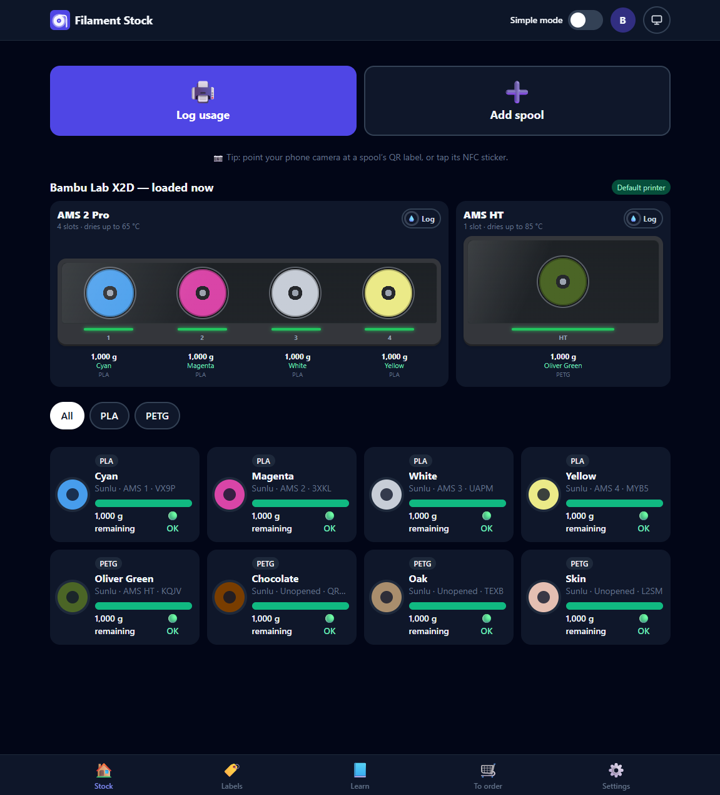
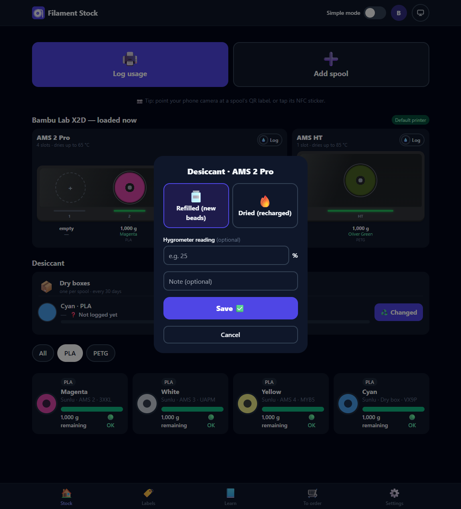
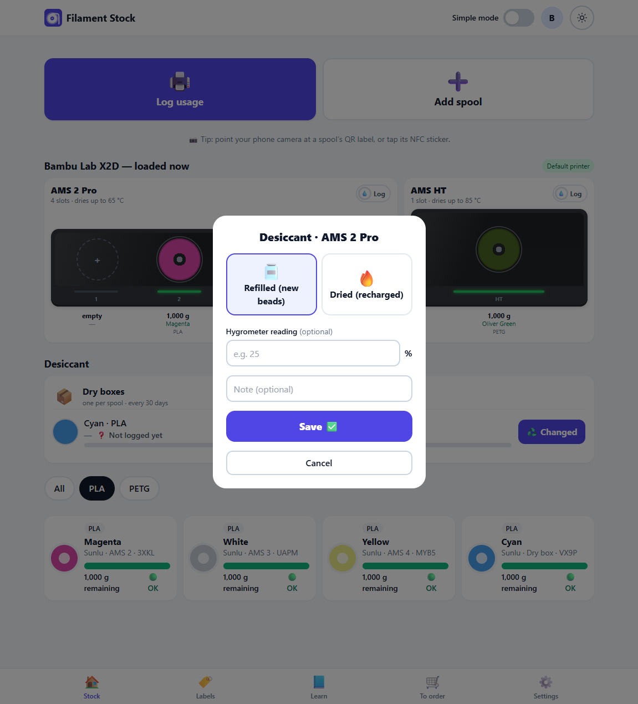
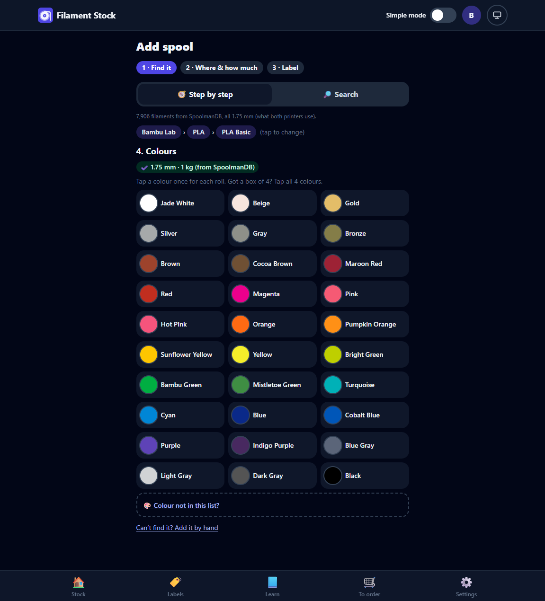
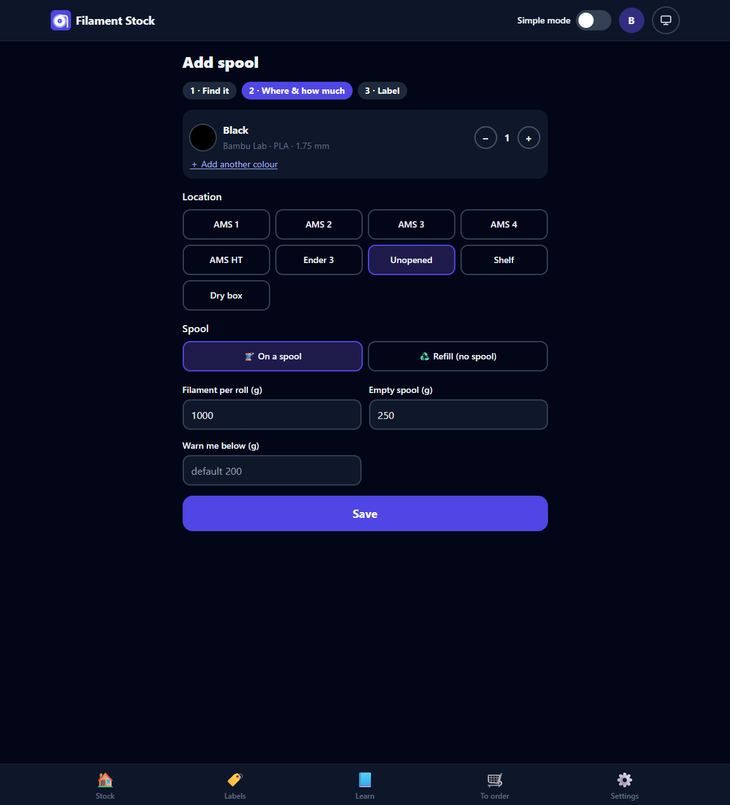
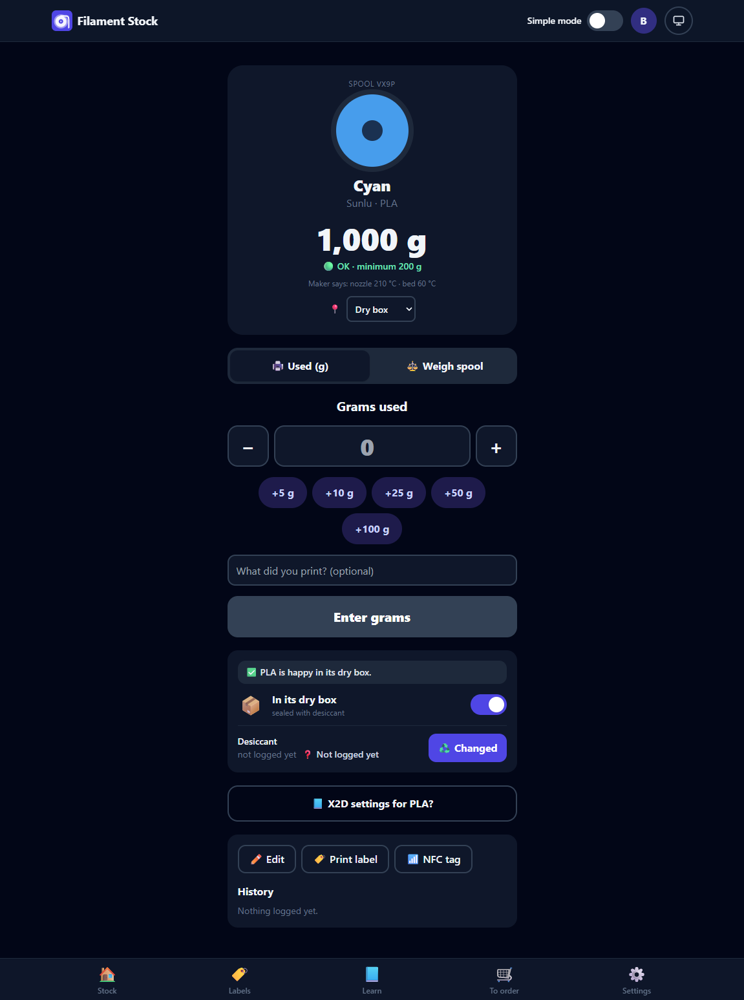
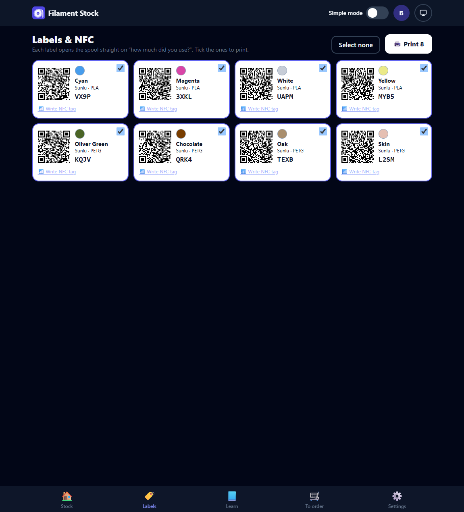

# Screenshots

What Filament Stock looks like on a computer. It works the same on a phone, with one column.
Back to the [readme](readme.md), or [open the app](https://balexandre.github.io/filament-stock/).

## Stock

The home screen: what's loaded in the **AMS 2 Pro** and **AMS HT**, a 💧 desiccant gauge in each
AMS card's corner, and every spool with how much is left.

## Desiccant

Tap an AMS card's 💧 gauge, or *Changed* on a dry box, to log that you refilled the beads or dried
them. You can also add a hygrometer reading. Shown in dark and light themes.

## Add spool

**Step by step:** Brand › Material › Type › Colours, straight from SpoolmanDB. It confirms
"1.75 mm · 1 kg", and you can tap several colours to add a whole multi-pack in one go.

Then choose where it goes (*Unopened* by default), whether it came on a spool or as a refill, and
when to warn you.

## A spool

What you see after scanning a spool's QR label or NFC sticker: grams left, quick buttons to log
what a print used (or weigh the spool), its dry box and desiccant, and a link to the X2D settings
for that material.

## Labels & NFC

Print QR labels for your spools, or write an NTAG215 NFC sticker for each one.

